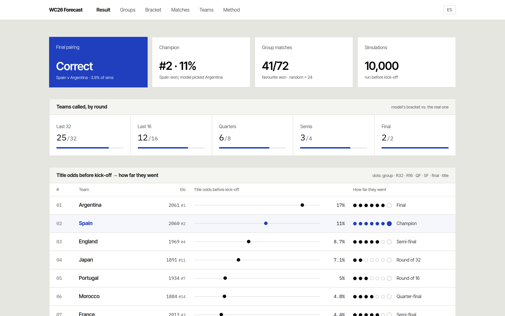
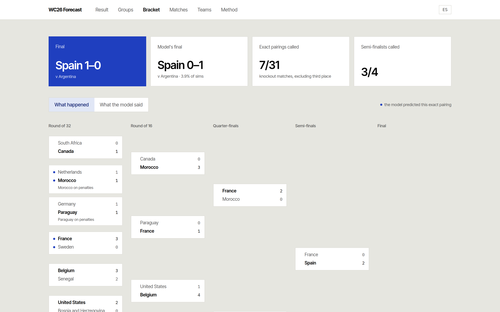
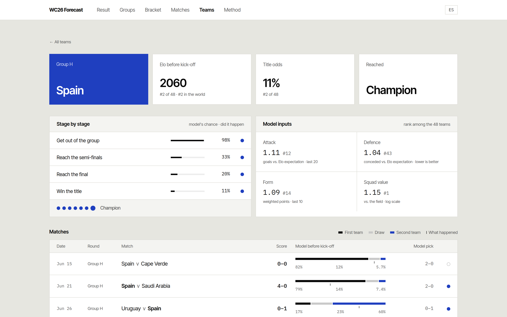
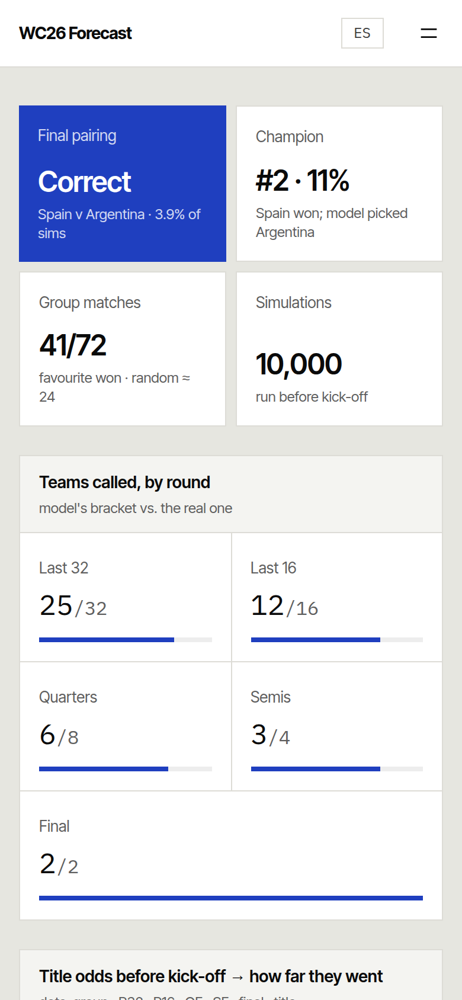

# World Cup 2026 Predictor

A statistical forecast of the FIFA World Cup 2026, made before the tournament and scored against what actually happened. Python model, bilingual Next.js site (EN/ES).

**[Live site →](https://worldcup-2026-predictor-delta.vercel.app/en)** · [Project report (PDF)](frontend/public/world-cup-2026-project-report-english.pdf) · [Informe en español](frontend/public/world-cup-2026-project-report.pdf)



## Results

| | |
|---|---|
| Final | Predicted Spain v Argentina, which was the real final (Spain won 1–0) |
| Champion | Spain was the model's #2 at 11%; its favourite, Argentina (17%), was runner-up |
| Teams called per round | Last 32: 25/32 · Last 16: 12/16 · QF: 6/8 · SF: 3/4 · Final: 2/2 |
| Matches | Group favourite won 41/72 (random ≈ 24) · knockout favourite went through 24/32 |
| Backtest | 2018, 2022 World Cups and Euro 2024: real champion in the top 5 in 14/15 runs |

## Methodology

1. **Elo ratings** from 49,405 international results since 1872.
2. **Team metrics**: attack and defence relative to Elo, recent form and squad market value.
3. **Match model**: expected goals per team, scores drawn from a Poisson distribution.
4. **Monte Carlo**: the full 48-team tournament simulated 10,000 times.

Calibrated by backtesting on three past tournaments, then evaluated against the real 2026 results without retraining. Details: [docs/methodology.md](docs/methodology.md) · [docs/architecture.md](docs/architecture.md)

## Screenshots

| Bracket: real vs. model | Team profile | Mobile |
|---|---|---|
|  |  |  |

## Stack

- **Model:** Python 3.11, pandas, numpy; 250+ pytest tests.
- **Site:** Next.js 16 (static pages), React 19, TypeScript, Tailwind CSS 4. Charts in plain HTML/CSS, English and Spanish routes, deployed on Vercel.

## Data

- International results 1872–2026: [martj42/international_results](https://github.com/martj42/international_results) (CC0 1.0).
- Tournament format, groups and best-third-place table: FIFA World Cup 2026 regulations.
- Squad market values: [Transfermarkt](https://www.transfermarkt.com), manually compiled snapshot in `data/external/teams_value.json` (EUR millions), used for non-commercial research.

## Run

```bash
cd frontend && npm install && npm run dev   # http://localhost:3000
```
